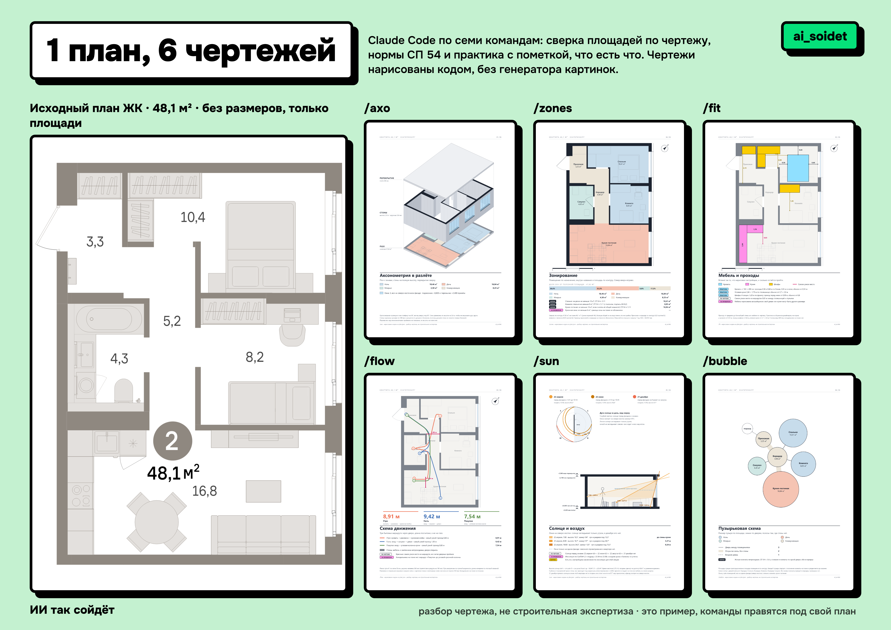
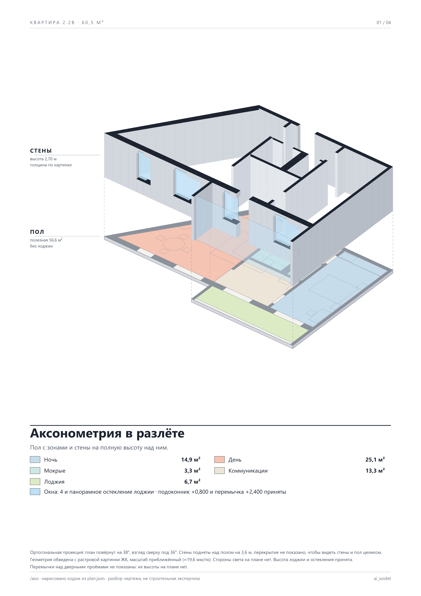

# claude-plan-check

Claude Code разбирает план квартиры из ЖК: рисует 6 чертежей кодом, сверяет площади с подписями застройщика, проверяет то, что по одному плану проверить можно, и составляет вопросы в отдел продаж.



**Это пример, а не продукт.** Разбор чертежа, не строительная экспертиза. Команды, пороги и оформление правятся под свой план и свои задачи.

Идея: PDF «1 plan, 6 drawings» от [archi.tactics](https://www.instagram.com/archi.tactics/) в Instagram, где промпт пишут один раз и сохраняют как slash-команду. Тексты команд здесь свои, переписаны под российский рынок.

## Что внутри

| Команда | Лист | Что показывает |
|---|---|---|
| `/axo` | `out/01-axo.png` | аксонометрия в разлёте: пол с зонами и стены с окнами над ним |
| `/fit` | `out/02-fit.png` | кровать, кухня и шкафы с плана, проходы рядом, самое узкое место |
| `/flow` | `out/03-flow.png` | три бытовых маршрута через двери (A*), длина и самое узкое место |
| `/zones` | `out/04-zones.png` | зоны, площади по контуру против подписей, нормы СП 54 п. 5.11 |
| `/sun` | `out/05-sun.png` | когда солнце стоит перед окнами 22 апреля, 22 июня, 22 августа и 21 декабря, глубина луча |
| `/bubble` | `out/06-bubble.png` | связи помещений по дверям, непроходные комнаты (СП 54 п. 5.6) |
| `/board` | `out/07-board.png` | всё на одном A3 |

Правила для Claude лежат в [`CLAUDE.md`](CLAUDE.md), команды в [`.claude/commands/`](.claude/commands/).

## Если у плана только картинка

В папке [`raster/`](raster/) второй пример: планировка 2.2в с косой стеной по картинке с сайта ЖК, без размеров и севера. Там обобщённые скрипты (стены многоугольниками), помощник обводки `trace_raster.py` и правила для растра: масштаб приближённый, площади берутся из подписей ЖК, размеры с обводки помечены «приближённо».



## Что отличает от «просто нарисуй»

- **Масштаб по площадям.** На планах ЖК нет размеров, только площади комнат. Масштаб считается по двум помещениям, замкнутым стенами, расхождение между ними больше 2% означает ошибку контура.
- **Все слои плана.** Пилоны прячутся в слоях «Несущие_колонны» и «Элементы_узлов», посудомойка и плита в «Электрооборудовании». В примере пропущенный пилон менял площадь комнаты на 0,15 м².
- **Уровень у каждого утверждения:** НОРМА (с пунктом), ПРАКТИКА (эвристика дизайнеров, не норма), ПО ЧЕРТЕЖУ, НЕ ПРОВЕРЕНО, ВОПРОС. Нет данных, значит «не проверено», а не «соответствует». Вердиктов и баллов нет.
- **Ни одной выдуманной цифры.** Всё считается из `plan.json`, допущения подписаны «принято».

## Пример: двушка 48,1 м², Екатеринбург

| Что | По чертежу | На плане ЖК | Уровень |
|---|---|---|---|
| Комната | 8,05 м² с пилоном | 8,2 | НОРМА: спальня от 8 м² |
| Спальня | 10,41 м² | 10,4 | НОРМА: на двоих от 10 м² |
| Прихожая и коридор | 8,23 м² | 8,5 | ВОПРОС: как считали |
| Жилые комнаты | обе выходят в коридор | | НОРМА: непроходные |
| Проходы у кровати 160 | 0,58 и 0,68 м | | ПРАКТИКА: от 0,55 м |
| Угловая кухня | 2,84 × 1,79 м | | ПРАКТИКА: от 2,7 × 2,0 м |
| Солнце перед окнами (СВ) | 22.04: 4,6 ч, 21.12: нет | | НЕ ПРОВЕРЕНО: соседние дома не учтены |

Сумма подписей 48,2 против общей 48,1: это округление каждой подписи, не ошибка.

## Как запустить

Проще всего: скинь архив или ссылку на репозиторий и свой план в Claude Code и напиши «Поставь этот скилл по УСТАНОВКА.md и разбери мой план». Шаги для агента лежат в [УСТАНОВКА.md](УСТАНОВКА.md).

Вручную:

Нужны [Claude Code](https://claude.com/claude-code), Node.js 20+ и Chrome (для планшета и карточек).

```bash
git clone https://github.com/AIsoidet/claude-plan-check
cd claude-plan-check
npm install
```

Пересобрать пример целиком:

```bash
npm run all
```

Подробно по шагам: [УСТАНОВКА.md](УСТАНОВКА.md).

Свой план: положи файл в `src/` (лучше векторный SVG или PDF с сайта ЖК; если только картинка, смотри [`raster/`](raster/)), удали `plan.json`, открой папку в Claude Code и набери `/zones`. Claude прочитает план, запишет `plan.json`, сверит площади и остановится, если что-то не сходится. Город, север и высоту потолка он спросит.

## Ограничения

- Скрипты в `tools/` написаны под этот план: координаты помещений в `make_plan.py`, точки остановок маршрутов в `flow.mjs`. Для другого плана Claude перепишет их по командам, это нормальная часть работы.
- Раковина и стиральная машина в примере сняты с картинки: в векторных слоях они мельче порога.
- Инсоляцию, КЕО, что над и под квартирой и площадь по ДДУ по одному плану не проверить: это вопросы застройщику, а не выводы.
- Нормы: СП 54.13330.2022 (пп. 5.6, 5.11), СанПиН 1.2.3685-21 (табл. 5.58). Пороги практики взяты из сборников дизайнеров и помечены как практика.

## Лицензия

MIT. Исходный план в `src/` принадлежит застройщику и лежит здесь как пример входных данных.

Канал: [t.me/ai_soidet](https://t.me/ai_soidet)
