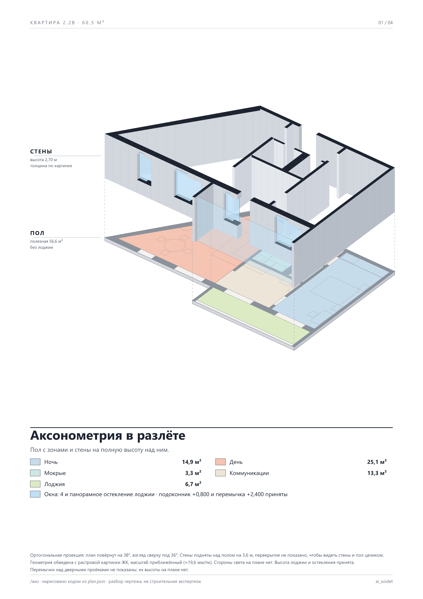

# Растровый план: обводка картинки с сайта ЖК

Основной пример репозитория (`../plan.json`) собран по векторному SVG. Здесь второй путь: на входе только картинка (PNG, JPG, WebP) без размеров и севера. Пример: планировка 2.2в, 60,5 м², с косой стеной и круговой планировкой.

Это отдельная папка со своими скриптами: они читают стены многоугольниками (не только прямоугольниками), окна и двери по концам проёма, мебель многоугольниками. Север, город и широта необязательны, листа солнца здесь нет.

## Что получается

| Лист | Файл |
|---|---|
| аксонометрия в разлёте | `out/01-axo.png` |
| мебель и проходы | `out/02-fit.png` |
| три маршрута | `out/03-flow.png` |
| зоны и нормы | `out/04-zones.png` |

Вопросы застройщику лежат в `out/checks.json`.

## Как это делается с картинкой

1. Положи картинку в `src/plan.png` (в репозитории её нет: план принадлежит застройщику).
2. `python tools/trace_raster.py mask src/plan.png` делает маску стен по цвету; тонкие линии мебели и дуги дверей при этом пропадают.
3. `python tools/trace_raster.py scan out/_walls_mask.png row 567 130 800` показывает куски стены вдоль строки или столбца: разрывы это двери и окна, их ширина в пикселях даёт проёмы.
4. Многоугольники помещений, стен, мебели, окон и дверей Claude обводит в пикселях и переводит в мм в `plan.json`; в `plan.json` → `trace` лежат масштаб и начало координат.
5. `python tools/trace_raster.py overlay` рисует обводку поверх картинки (`out/_overlay.png`): проверь глазами стены, двери (куда открываются), тонкие перегородки и ниши.
6. Порядок листов: `node tools/flow.mjs && node tools/checks.mjs && node tools/fit.mjs && node tools/zones.mjs && node tools/axo.mjs && node tools/board.mjs` (запускать из этой папки; нужен `npm install` в корне, для планшета Chrome и Pillow).

## Чем растр отличается от SVG

- **Масштаб приближённый.** Считай по площадям крупных комнат и сверяй по ширине дверей (около 0,8–0,9 м). У растра разброс по помещениям 10–20%; правило «больше 2% значит стоп» из корня здесь не работает, потому что маркетинговая картинка не в масштабе.
- **Площади в таблицах из подписей ЖК**, а не по контуру. Расхождение контура с подписью это неточность обводки, а не находка. Размеры, снятые с обводки, подписываются «приближённо» и «принято».
- **Рисуй как на картинке.** Тонкая линия остаётся тонкой, а не стеной. Ниша в комнате не отдельная комната. Полотно двери не должно заходить в мебель, а острый угол стен не должен давать выступ.
- **Чего нет на картинке, не придумывай:** север, высоту потолка, окна на лоджии. Спроси или запиши «принято».
